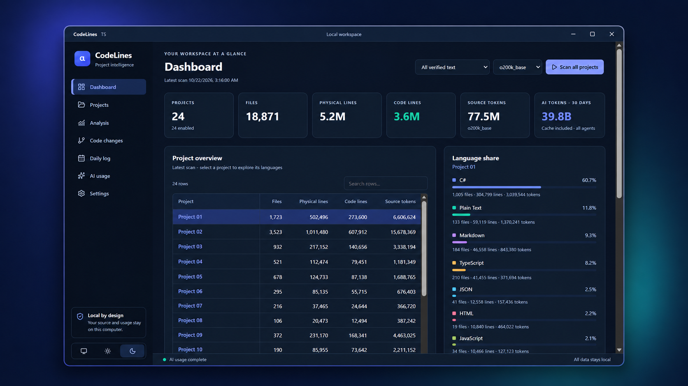
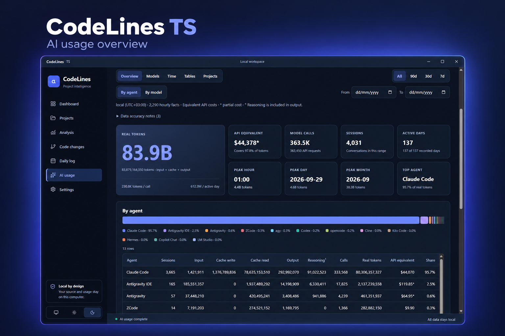

# CodeLines TS

An offline Windows desktop replacement for CodeLines, implemented with Electron, strict TypeScript, and React. All seven pages are integrated: Dashboard, Projects, Analysis, Code changes, Daily log, AI usage, and Settings. No .NET runtime, ccstats checkout, backend service, account, API key, or development server is required by the packaged application.

<p align="center">
  <a href="docs/screenshots/dashboard-anonymized.png">
    
  </a>
</p>

<p align="center">
  <em>Workspace dashboard with project metrics and language distribution. Project names have been replaced with generic labels for privacy.</em><br />
  <a href="docs/screenshots/dashboard-anonymized.png">View the anonymized dashboard at full resolution</a>
</p>

<p align="center">
  <a href="docs/screenshots/ai-usage-overview.png">
    
  </a>
</p>

<p align="center">
  <em>AI usage overview with token totals, API cost equivalents, session statistics, and a breakdown by agent.</em><br />
  <a href="docs/screenshots/ai-usage-overview.png">View the original screenshot at full resolution</a>
</p>

## Install or run

Download **[v1.0.0 for Windows x64](https://github.com/m51j/CodeLines-TS/releases/tag/v1.0.0)**: [installer](https://github.com/m51j/CodeLines-TS/releases/download/v1.0.0/CodeLines.TS.Setup.1.0.0.exe), [portable executable](https://github.com/m51j/CodeLines-TS/releases/download/v1.0.0/CodeLines.TS.1.0.0.exe), and [SHA256 checksums](https://github.com/m51j/CodeLines-TS/releases/download/v1.0.0/SHA256SUMS.txt). See [GitHub Releases](https://github.com/m51j/CodeLines-TS/releases) for later versions, or build from source using the instructions below. Executables are build outputs and are not included in a source checkout. GitHub download names use periods in place of spaces; the published checksum manifest uses those download names.

For a local build, use `release/CodeLines TS Setup 1.0.0.exe` for an installable application, or `release/CodeLines TS 1.0.0.exe` for the portable executable. Builds are unsigned. Windows may identify the publisher as unknown. The installer preserves application data on uninstall. Windows x64 is the supported packaging target.

Packaging also generates `release/SHA256SUMS.txt` for both executables. Run `npm run checksums:verify` to check a local build. To verify downloaded files without Node.js, place both executables and `SHA256SUMS.txt` in one folder and run this PowerShell command from that folder; it throws if a file is missing or its content differs:

```powershell
$entries = @(Get-Content -LiteralPath .\SHA256SUMS.txt -ErrorAction Stop)
if ($entries.Count -ne 2) { throw "Expected checksums for both executables" }
$entries | ForEach-Object {
  if ($_ -notmatch '^([a-fA-F0-9]{64})  (.+)$') { throw "Invalid checksum entry" }
  $expected = $Matches[1]
  $file = $Matches[2]
  $actual = (Get-FileHash -LiteralPath $file -Algorithm SHA256 -ErrorAction Stop).Hash
  if ($actual -ine $expected) { throw "Checksum mismatch: $file" }
  Write-Host "Verified: $file"
}
```

Git must be installed on PATH only for the optional history feature. SQLite is part of Electron's bundled Node runtime. Both tokenizer vocabularies are bundled into the scan worker. Runtime analysis does not download anything.

## Reproducible development

Requirements: Windows, Node.js 24+, npm, and Git for history tests. Run from this directory:

On Windows, double-click `run.bat` to build and launch the application, or `build-release.bat` to build both the installer and portable executable in `release/`. Both scripts work from any current directory and run `npm ci` automatically when the required local tools are missing. The release script pauses when finished; both scripts pause on errors so the details remain visible.

```powershell
npm ci
npm run dev
npm run typecheck
npm run lint
npm test
npm run build
npm run start
npm run test:desktop
npm run package
npm run checksums:verify
npm run test:desktop -- --packaged
npm run test:portable
```

`npm run verify` runs type checking, lint, unit/service tests, and a production build. `npm ci` uses the checked-in lockfile. Development and packaging dependencies require network access at installation; the installed app works offline. The development command builds desktop entry points and starts a loopback-only Vite server. Renderer changes reload automatically; restart the command after main/preload/worker changes. Production startup loads local built files. `npm run package` builds Windows x64 executables and their checksums without publishing them; `npm run checksums` regenerates the manifest only when both nonempty executables exist.

`npm run test:desktop` launches Electron with isolated temporary projects, agent roots, and data. `--packaged` tests `release/win-unpacked/CodeLines TS.exe`. Set `CODELINES_TEST_EXECUTABLE` to test an installed executable instead. Desktop tests cover real workers, dialogs with test-selected paths, exports, UI navigation, themes, cancellation, conflicting operations, and offline standalone reports. Screenshots are saved under `artifacts/desktop/`.

## Local data and migration

New data is stored under `%LOCALAPPDATA%\CodeLines-TS`:

- `settings.json`: schema version 1, projects, settings, latest scan, latest complete history.
- `daily-log.json`: legacy-compatible daily schema version 1.
- `ai-report.json`: typed combined and Claude payloads plus adapter statuses.
- `ai-usage/cache/`: versioned per-source caches; full rescan bypasses them.
- `migration.json`, `migration-backups/`: import fingerprints and recoverable source/replacement copies.

Electron's Chromium profile uses the separate `CodeLines TS` user-data directory. `CODELINES_DATA_DIR` overrides both locations for isolated tests or a custom data location. `CODELINES_AGENT_HOME`, `CODELINES_AGENT_APPDATA`, and `CODELINES_AGENT_LOCALAPPDATA` redirect agent discovery in tests; production defaults are the current user's actual local agent locations.

In Settings, choose **Import legacy CodeLines data** to read `%LOCALAPPDATA%\CodeLines\settings.json` and `daily-log.json`. Import is explicit; development never reads or modifies legacy files automatically. First import into an empty replacement adopts legacy settings, project IDs, snapshots, and history. On subsequent imports current settings take precedence, projects merge by normalized path, identities are remapped consistently for duplicate roots, compatible snapshots merge, and daily entries keep the later per-project scan. Historical AI totals never shrink. Incompatible existing scan contracts remain separate in recovery copies. The exact source files and pre-import replacement state are backed up before writes. Repeating identical imports is idempotent.

Writes are serialized per file, flushed to unique temporary files, and atomically renamed. A `.bak` keeps the previous saved version. Malformed JSON/schema data is copied to `.invalid-<timestamp>-<id>` before recovery from `.bak` or defaults. An unreadable daily log prevents overwriting that log; resolve access and reopen the app to resume daily recording. Importing a malformed legacy document fails without changing it.

## Counting and exclusions

Scopes match the original: source only, source plus configuration, or all verified text. Physical, blank, code, comment-only, mixed, and documentation content lines retain their meanings. Mixed lines are included in code lines. A trailing newline does not create an extra physical line. The 38 language definitions retain their extensions, exact names, and comment delimiters.

Scanning handles BOMs, strict UTF-8, UTF-16, binary detection, file-size limits, bounded I/O parallelism, cancellation, and unreadable-path warnings. Symbolic links/junctions are skipped to prevent loops. Nested checkouts/worktrees are excluded. A folder named `packages` is excluded only when its contents identify a NuGet restore folder, preserving npm/pnpm workspaces.

Ignore precedence is global rules → root/nested `.gitignore` → project rules. Ordered negation, directory rules, `*`, `**`, `?`, and anchoring are supported. Default-exclusion revision 1 removes the retired `packages/` default and adds AI worktree defaults once, preserving other user edits. Counting retains the original lightweight string/comment state machine rather than claiming compiler-level parsing; see the audit notes for intentional compatibility details and defect fixes.

## Git history

Enable history in Settings. Periods are 7, 30, 365, or custom 1–36500 days. Activity compares every selected first-parent commit with its first parent; NetChange compares captured HEAD against the first older baseline or an empty tree. Merge changes are counted once. Working files are never included. Current ignore/scope settings apply to deleted and historical paths, repository subfolders, and renames across scope boundaries.

The app never fetches, checks out, writes Git objects, or accesses remotes. Missing Git, unavailable repositories, no commits, shallow boundaries, incomplete results, and cancellation have explicit states. Progress is coalesced at 250 ms, includes completed comparisons/files and partial project totals, and estimates only the current project's remaining time after sufficient progress. Estimated modified lines overlap additions/deletions; do not add them to added/deleted totals.

## Daily log

The latest scan of each project replaces that project's scan on the same local calendar day. Other projects remain. Timelines carry earlier values forward and identify them; deltas compare consecutive rows with line values. Compare two dates for overall and language differences. Scope/tokenizer changes and carried data produce comparison warnings. The default filter is all enabled projects, with individual project filters available.

AI facts use the selected local/UTC clock. Project usage is attributed by session start day and longest matching project root, including Git Bash/WSL paths. Historical AI totals cannot shrink when local source logs disappear; today is refreshed, and a day recorded under the other clock (local/UTC) is replaced. The “refresh AI usage after every scan” setting controls automatic post-scan refresh.

## AI adapters and reports

Supported: Claude Code, Codex (active and archived rollouts), Antigravity IDE, Antigravity, agy, ZCode, opencode, Kilo Code, Cline, Copilot Chat, Hermes, and LM Studio. Adapters read local JSON, JSONL, SQLite, and protobuf conversation records. Databases are opened read-only, with an isolated DB/WAL/SHM copy fallback for unavailable/locked stores.

Claude deduplication retains the greatest-output record for each request; raw mode remains available in the Claude report. For parity with the original, the combined report always deduplicates Claude even while its individual report is raw. Real token totals include both cache reads and writes; reasoning already included in output is not counted twice. Recorded costs take precedence, then frozen list prices. Claude session costs price each request at its own model's rate. Unknown agent prices remain unknown, partial costs carry `*`, and LM Studio's known zero is retained. Unknown Claude models retain the original fallback rate and are identified in the detailed report. Figures are API cost equivalents, not billing statements.

Combined/per-agent navigation, Overview/Models/Time/Tables/Projects tabs, date ranges, grouping, activity calendar, token-class distribution, daily/model stacks, hour/weekday heatmaps, monthly tables, cost coverage, full breakdowns, project tables, heaviest sessions, and Claude app-card comparisons share one typed report model and React implementation. Tables sort, search, paginate, and retain keyboard-focusable scroll regions, sticky headers/project columns, selectable full paths, truncation, and full-path tooltips. Agent tabs show all-time token counts and remember each agent’s tab, range, grouping and custom dates while the report stays open. Quick ranges are anchored to that agent’s latest recorded day and clear custom dates; entering a custom date switches to the custom period. Activity calendars include month/day labels, heatmaps include hour/day axes, and hover/focus tooltips show exact metrics. Agent source statuses are collapsible and highlight failures. These controls and visuals are shared with the offline HTML export.

Pricing version `codelines-2026-10-05-v1` is frozen from the original source, including its fallback rules. No price updates were made. Any future update must be explicit, versioned, sourced, and tested. See [attribution](THIRD-PARTY-NOTICES.md).

## Exports

- Projects: portable `codelines-projects` JSON; import also accepts a bare array or a legacy settings file's project list.
- Analysis: detailed per-file CSV and full snapshot JSON.
- History: CSV with `File`, `ProjectStatus`, and `Totals` record types; JSON with aggregate totals. Filter CSV to `File` before summing to avoid double counting.
- Daily log: CSV of the active project/AI filter, values, deltas, and carry-forward notes.
- AI usage: legacy-shaped combined JSON or one self-contained offline HTML file. The export bundles React, charts, styles, data, and the exact same selectors as the desktop report. It has no iframe or IPC requirement. Open in browser writes that same report and asks the operating system to open it.

CSV string cells are escaped and protected against spreadsheet formula injection. HTML data escapes script delimiters; untrusted values render as React text.

## Architecture

`src/main/`: lifecycle, trusted IPC handlers, native dialogs, serialization, worker orchestration. The preload exposes only named operations. The renderer uses context isolation, Node integration off, sandboxing on, restricted navigation, denied permissions, and blocked external network requests.

`src/shared/`: strict contracts, request validation, persisted schemas, structured failure envelopes. `src/domain/`: pure language/line/metric/daily/history calculations. `src/services/`: filesystem scanning, BPE, ignore matching, Git, persistence, migration, and exports. `src/ai/`: all adapters, cache, read-only SQLite access, protobuf, aggregation, and frozen rates. `src/reports/`: pure shared report selectors. `src/renderer/`: React UI, shared controls, reports, and theme tokens.

Heavy work runs in background workers. Scan/history share an exclusive lane; AI has its own lane. Cancellation IDs and active-generation checks prevent stale progress/results. Settings/project mutation is blocked during active work. No arbitrary filesystem, SQL, IPC, or shell API is available to renderer code.

See [feature parity](docs/FEATURE-PARITY.md), [audit resolutions](docs/AUDIT.md), and [verification](docs/VERIFICATION.md) for evidence and exact verification limits. macOS/Linux packaging and platform-specific visual behavior have not been verified; native Git/path/data-root operations are isolated from the domain layer.

## Contributing and maintenance

See [CONTRIBUTING.md](CONTRIBUTING.md) for development and pull request checks, [SECURITY.md](SECURITY.md) for private vulnerability reporting, and [CHANGELOG.md](CHANGELOG.md) for release notes. Report ordinary bugs and feature requests through [GitHub Issues](https://github.com/m51j/CodeLines-TS/issues); remove private project paths, transcripts, and credentials from attachments.

GitHub Actions checks Windows/Node 24 installations, dependency advisories, source builds, and the desktop suite on pushes and pull requests. The manually dispatched **Build release artifacts** workflow also packages and tests the unpacked and portable executables, verifies checksums, and uploads build artifacts. It does not create a GitHub Release. Dependabot proposes weekly npm and workflow dependency updates; updates require review and are not automatically merged. Maintainers should follow the [publication checklist](docs/PUBLISHING.md) before making the repository public or publishing binaries.

## License

Copyright (c) 2026 m51j. Licensed under the [MIT License](LICENSE). See [third-party attribution](THIRD-PARTY-NOTICES.md) and [dependency license texts](docs/THIRD-PARTY-LICENSES.txt) for upstream notices. The package remains marked `private` to prevent accidental npm publication; this does not restrict public GitHub hosting.
