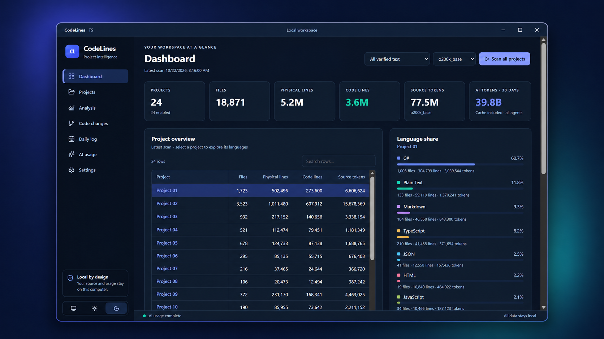
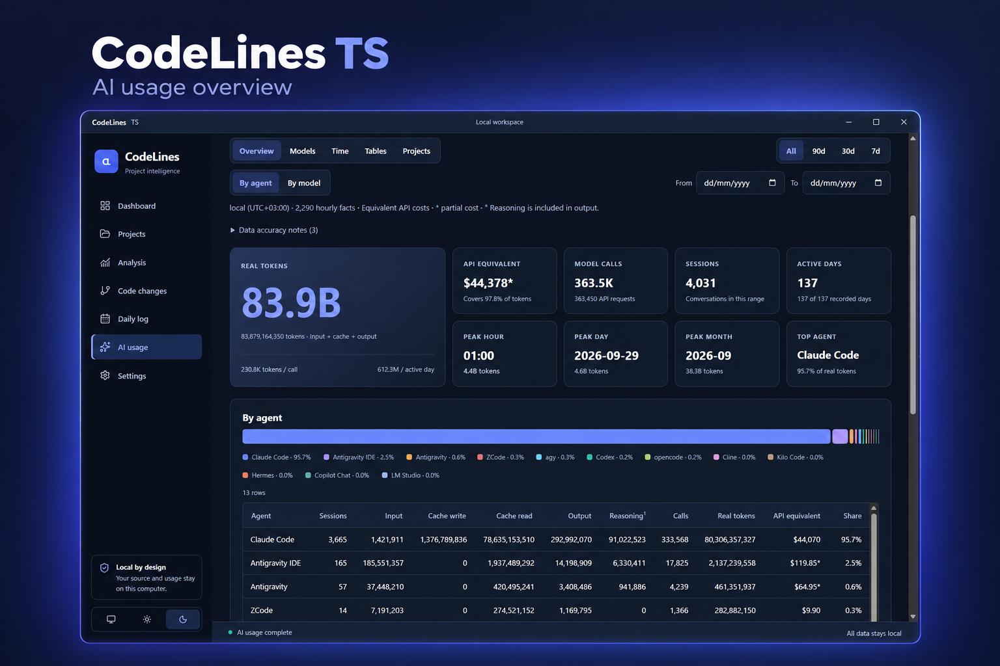
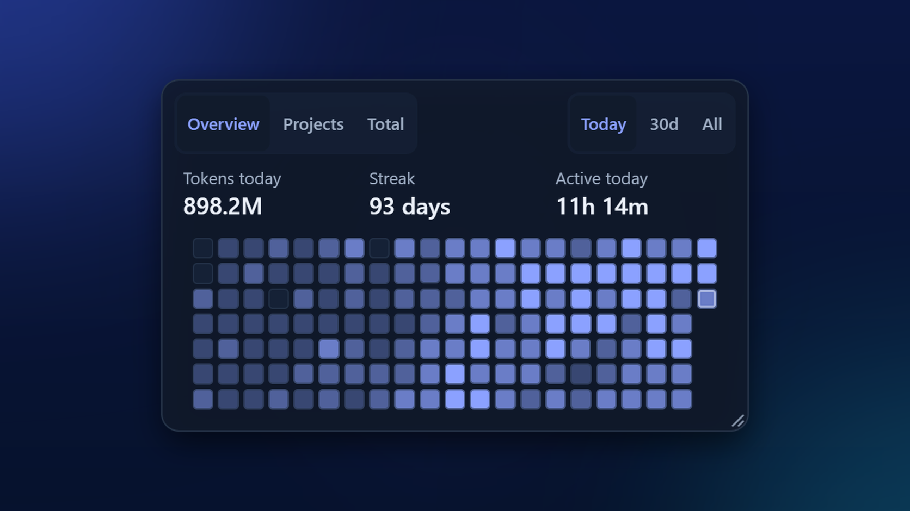

# CodeLines

CodeLines is an offline Windows desktop app for understanding your codebase and tracking AI coding activity. Analyze project size and languages, explore Git changes, compare daily progress, and review local AI usage in one workspace. Your projects and usage records stay on your computer; no account, API key, or backend service is required.

## Features

- **Workspace dashboard:** project, file, line, and token totals with language distribution and recent AI activity.
- **Project analysis:** scan individual projects or your whole workspace, inspect per-file metrics, and customize exclusions.
- **Git changes:** explore committed activity and net changes over a selected period.
- **Daily log:** track project growth and compare dates, projects, and languages.
- **AI usage:** review tokens, sessions, models, activity, and API cost equivalents from local coding-agent records.
- **Desktop widget:** turn it on in **Settings** for a small translucent window with today's tokens, active time, streak, a fitted activity heatmap, top projects and code totals. It refreshes in the background, stays in the notification area when CodeLines closes, and can start with Windows.
- **Portable reports:** export CSV and JSON, or share a self-contained AI usage HTML report that opens offline.
- **Desktop controls:** light, dark, and system themes, project import/export, and local data recovery.

## Screenshots

<p align="center">
  <a href="docs/screenshots/dashboard-anonymized.png">
    
  </a>
</p>

<p align="center">
  <em>Workspace dashboard with project metrics and language distribution. Project names have been replaced with generic labels for privacy.</em><br />
  <a href="docs/screenshots/dashboard-anonymized.png">View the anonymized dashboard at full resolution</a>
</p>

<p align="center">
  <a href="docs/screenshots/ai-usage-overview.png">
    
  </a>
</p>

<p align="center">
  <em>AI usage overview with token totals, API cost equivalents, session statistics, and a breakdown by agent.</em><br />
  <a href="docs/screenshots/ai-usage-overview.png">View the AI usage overview at full resolution</a>
</p>

## Desktop widget

<p align="center">
  <a href="docs/screenshots/desktop-widget.png">
    
  </a>
</p>

<p align="center">
  <em>The desktop widget keeps today's AI activity in view without opening CodeLines.</em><br />
  <a href="docs/screenshots/desktop-widget.png">View the widget at actual size</a>
</p>

Turn on **Show the widget on the desktop** in **Settings** to open a small translucent window that sits on your desktop:

- **Overview:** tokens, active time, and your current streak for **Today**, **30d**, or **All**, above an activity heatmap that fills the space you give it.
- **Projects:** time and tokens per project for the selected period.
- **Total:** all-time AI usage alongside your code totals.

Drag the widget to move it and drag its corner to resize it; its position, size, tab, and period are remembered. The widget refreshes AI usage in the background (every 5 minutes by default) and follows the app's light or dark theme. While it is on, closing the main window keeps CodeLines in the notification area; the tray menu opens CodeLines, shows or hides the widget, refreshes AI usage now, or quits. In **Settings** you can also keep the widget above other windows, change the refresh interval, and start CodeLines with Windows.

## Install

Download the Windows x64 installer or portable executable from **[GitHub Releases](https://github.com/m51j/CodeLines-TS/releases)**. The installer preserves application data on uninstall. For the portable version, run the executable directly.

Builds are unsigned, so Windows may identify the publisher as unknown. Each release includes a SHA256 checksum manifest; see [download verification](docs/TECHNICAL.md#verify-downloads).

The installed app works offline. Install Git and make it available on PATH if you want to use the optional history feature.

## Get started

1. Add your project folders on the **Projects** page.
2. Choose **Scan all projects**, then explore **Dashboard** and **Analysis**.
3. Enable Git history in **Settings** to use **Code changes**.
4. Open **Daily log** to track scans over time, or **AI usage** to review supported local agent records.
5. Export the results from the relevant page as a report or data file.

AI usage supports Claude Code, Codex, Antigravity IDE, Antigravity, agy, ZCode, opencode, Kilo Code, Cline, Copilot Chat, Hermes, and LM Studio. Cost figures are API cost equivalents based on recorded costs or frozen rates, not billing statements.

## Run from source

Requirements: Windows, Node.js 24+, and npm. Git is needed for history tests.

```powershell
npm ci
npm run dev
```

On Windows, you can also double-click `run.bat` to build and launch the app. To create an installer and portable executable, use `build-release.bat` or:

```powershell
npm run package
```

Local builds produce `release/CodeLines Setup 1.1.0.exe`, `release/CodeLines 1.1.0.exe`, and `release/SHA256SUMS.txt`.

See the [technical reference](docs/TECHNICAL.md) for development commands, tests, packaging, storage, imports, analysis rules, and architecture.

## Documentation and feedback

- [Technical reference](docs/TECHNICAL.md)
- [Contributing](CONTRIBUTING.md)
- [Release notes](CHANGELOG.md)
- [Report a bug or request a feature](https://github.com/m51j/CodeLines-TS/issues)
- [Report a security vulnerability](SECURITY.md)

## License

Copyright (c) 2026 m51j. Licensed under the [MIT License](LICENSE). See [third-party attribution](THIRD-PARTY-NOTICES.md) and [dependency license texts](docs/THIRD-PARTY-LICENSES.txt).
